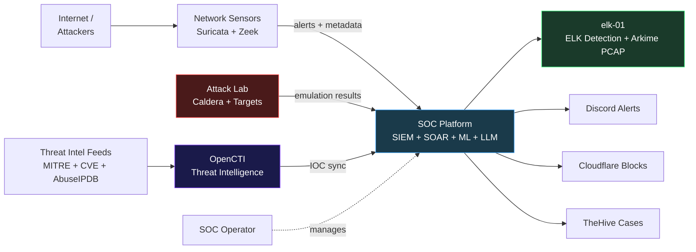
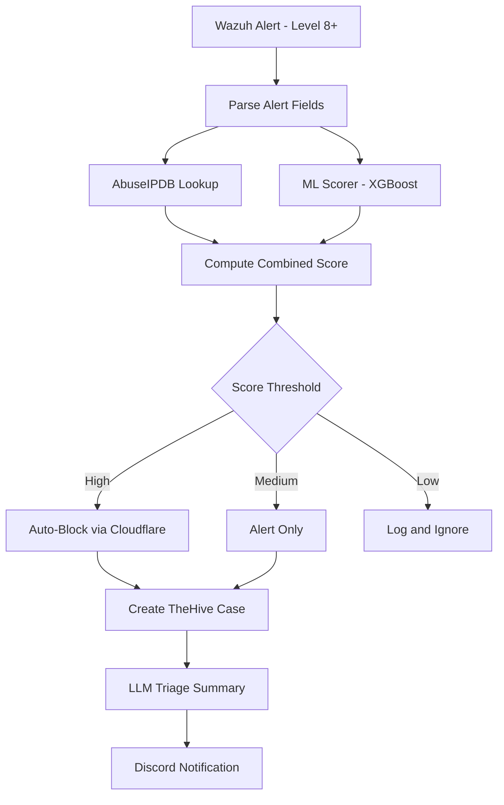

# HomeLab SOC

> Enterprise-grade Security Operations Center built on commodity hardware: SIEM, SOAR, DFIR, ML threat detection, LLM-augmented automation, full-packet capture, and FedRAMP Low ConMon program.

              

**What this repository is:** the sanitized configuration, automation code and engineering write-ups for a working home-lab SOC. Network sensors (Suricata, Zeek, Arkime) and endpoint agents (Wazuh, Elastic Defend, Velociraptor) feed two SIEMs (Wazuh and Elastic); Shuffle SOAR workflows enrich alerts with threat intel (OpenCTI, AbuseIPDB, Cortex), an XGBoost scorer and a local LLM (Ollama), then open TheHive cases, post to Discord and can block at Cloudflare. Caldera adversary emulation is used to validate detections. Credentials, account names and per-install IDs are replaced with placeholders (see [Reproducing it](#reproducing-it)).

---

## Architecture



---

## Key Metrics

| Metric | Value |
|--------|-------|
| Wazuh agents | **15** across 5 VLANs + GCP cloud |
| SOAR workflows | **18** exported (17 active, 1 decommissioned); **12** call a local LLM via Ollama |
| Elastic detection rules | **1,419** in the exported rule set ([`elastic/detection-rules/`](elastic/detection-rules/)), 214 enabled in the export |
| ML threat scorer | **PR-AUC 0.9998** (XGBoost binary classifier) |
| Velociraptor DFIR clients | **7** endpoints |
| Docker containers (soc-01) | **12+** services |
| MITRE ATT&CK adversary profiles | **29** (Caldera) |
| Cortex analyzers | **5** (AbuseIPDB, VirusTotal, Shodan, Abuse Finder, GoogleDNS) |
| Threat intel connectors | **9** (OpenCTI: MITRE ATT&CK, CVE, AbuseIPDB, CISA KEV, Malpedia, AlienVault OTX, Abuse.ch URLhaus, Abuse.ch ThreatFox, Abuse.ch SSL Blacklist) |
| Elastic ML anomaly jobs | **1** (auth anomaly detection on Windows Security events; Elastic ML trial expired 2026-04-16, switched to basic license; job preserved as historical record) |
| Total cluster RAM | **208 GB** across 7 hosts |
| Build duration | **4 days** initial + **3 days** redesign |

---

## Migration Phases

Phases 1-11 completed February 10-13, 2026. Phase 12 (infrastructure redesign) completed March 2026. Phases 13-14 (Arkime PCAP + elk-01 data foundation) completed March-April 2026. Phase 15 (FedRAMP Low ConMon) completed April 10, 2026. Full engineering narrative with key decisions, challenges, and outcomes for phases 1-12 is in [docs/phases.md](docs/phases.md); phases 13-15 are summarized in the table below.

| Phase | Name | Summary |
|:-----:|------|---------|
| :white_check_mark: 1 | **soc-01 Online** | Ubuntu 24.04, Docker, NVIDIA RTX A1000, Ollama, Prometheus + Grafana |
| :white_check_mark: 2 | **Wazuh SIEM** | 15 agents, Zeek pipeline (7 indices), MokerLink ACL micro-segmentation |
| :white_check_mark: 3 | **Hard Cutover** | sensor-01 converted to sensor-only, 38 GB backed up |
| :white_check_mark: 4 | **Case Management** | TheHive 4 + Cortex 3 on Proxmox LXC, 5 analyzers |
| :white_check_mark: 5 | **Shuffle SOAR** | WF1 (enrichment + auto-block), WF2 (watch digest) |
| :white_check_mark: 6 | **Velociraptor DFIR** | 7 clients enrolled across all platforms |
| :white_check_mark: 7 | **Caldera Adversary Emulation** | 4 Sandcat agents, Wazuh detection validated |
| :white_check_mark: 8 | **ML Pipeline v3** | 6 models + hybrid, XGBoost PR-AUC 0.9998, deployed to ml-scorer |
| :white_check_mark: 9 | **Ollama LLM Integration** | 7 workflows using qwen3:8b for triage and analysis |
| :white_check_mark: 10 | **ELK Stack (Dual-SIEM)** | Elasticsearch 8.17, 1,345 detection rules, migrated to elk-01 bare metal |
| :white_check_mark: 11 | **Proxmox Backup Server** | NFS to sensor-01 17 TB, daily + weekly backup jobs |
| :white_check_mark: 12 | **Infrastructure Redesign** | elk-01 bare metal (ELK + Arkime), OpenCTI threat intel, v2 metrics decommission |
| :white_check_mark: 13 | **Arkime Packet Capture** | Full-packet capture on elk-01 bare metal (span0 SPAN port, 2 TB PCAP storage) |
| :white_check_mark: 14 | **elk-01 Data Foundation** | Zeek on span0 (JA3/JA4/community-id), Logstash enrichment (OpenCTI + Ollama LLM), PCAP archival to sensor-01, nightly briefing |
| :white_check_mark: 15 | **FedRAMP Low ConMon** | 156-control SSP, OSCAL pipelines, 4 ConMon plans complete, DefectDojo + RegScale integration, public portfolio at github.com/brianchaplow/homelab-fedramp-low |

---

## Table of Contents

- [Architecture](#architecture)
- [Key Metrics](#key-metrics)
- [Migration Phases](#migration-phases)
- [Network Topology](#network-topology)
- [SOAR Workflows](#soar-workflows)
- [ML Pipeline](#ml-pipeline)
- [Honeypot Research (Historical)](#honeypot-research-historical)
- [Getting Started](#getting-started)
- [Reproducing it](#reproducing-it)
- [Tests](#tests)
- [Lessons Learned](#lessons-learned)

**Component Documentation:**

| Folder | Description |
|--------|-------------|
| [`docs/guides/`](docs/guides/) | **Portfolio overview** and **SOC playbook** -- comprehensive analyst guides |
| [`docs/`](docs/) | Architecture, network topology, migration phases |
| [`wazuh/`](wazuh/) | SIEM -- rules, decoders, agent configs |
| [`elastic/`](elastic/) | ELK Stack -- detection rules, dashboards, Fleet policies |
| [`shuffle/`](shuffle/) | SOAR -- workflow JSON exports, trigger scripts |
| [`ml-pipeline/`](ml-pipeline/) | ML threat detection -- model card, architecture |
| [`honeypot/`](honeypot/) | Honeypot research -- sync scripts, dashboards |
| [`incident-response/`](incident-response/) | Velociraptor DFIR -- deployment configs |
| [`adversary-simulation/`](adversary-simulation/) | Caldera -- adversary profiles, attack scripts |
| [`infrastructure/`](infrastructure/) | Docker Compose files, deployment configs |
| [`scripts/`](scripts/) | Operational automation scripts (incl. the v2 Python automation suite) |
| [`inventory/`](inventory/) | Asset inventory (criticality + normal role) used to ground LLM triage |
| [`tests/`](tests/) | pytest suite for the automation code and config validation |

---

## Network Topology

Five VLANs routed through OPNsense with strict inter-VLAN firewall rules and switch-level ACL micro-segmentation. Hostnames (`soc-01`, `elk-01`, `sensor-01`, ...), VLAN IDs and addresses in this repository are role-based placeholders; the segmentation is the real design.

| VLAN | Subnet | Purpose |
|------|--------|---------|
| 100 | 172.20.1.0/24 | Management -- firewall, switch, workstation |
| 200 | 172.20.2.0/24 | SOC infrastructure -- SIEM, sensors, attack box |
| 300 | 172.20.3.0/24 | Lab -- Proxmox, AD domain, incident response |
| 400 | 172.20.4.0/24 | Targets -- **fully isolated**, attack surfaces only |
| 500 | 172.20.5.0/24 | IoT -- internet-only, no lateral movement |

Full topology, firewall rules, and switch ACL details in [docs/network-topology.md](docs/network-topology.md).

<details>
<summary><strong>Hardware Inventory</strong></summary>

| Host | Hardware | Role |
|------|----------|------|
| **soc-01** | Lenovo ThinkStation P3 Tiny (Ultra 9 285, 64 GB, RTX A1000) | v3 SOC platform -- SIEM, SOAR, DFIR, ML, LLM |
| **sensor-01** | QNAP TVS-871 (i7-4790S, 16 GB, 32 TB RAID) | Network sensor (Suricata + Zeek), backup target |
| **attack-01** | ASUS ROG Strix G512LI (i5-10300H, 32 GB, GTX 1650 Ti) | Kali attack box, ML model training |
| **elk-01** | Lenovo ThinkStation P340 Tiny (i7-10700T, 32 GB) | Detection & PCAP -- ELK 8.17 + Arkime full packet capture |
| **pve-01** | Lenovo ThinkStation P340 Tiny (i7-10700T, 32 GB) | Proxmox VE -- AD lab, TheHive, OpenCTI |
| **pve-02** | Lenovo ThinkStation P340 Tiny (i7-10700T, 32 GB) | Proxmox VE -- Caldera, attack targets, PBS |
| **ADMIN-WS** | ASUS TUF Dash F15 (i7-12650H, 64 GB) | Management workstation (Windows 11) |
| **OPNsense** | Protectli VP2420 (J6412, 8 GB) | Firewall / router -- inter-VLAN routing, NAT |
| **MokerLink** | 10G08410GSM (8x 10GbE + 4x SFP+) | L3 managed switch -- SPAN port mirroring, ACL |
| **GCP VM** | Google Cloud e2-medium (2 vCPU, 4 GB) | External honeypot, portfolio hosting, Wazuh agent |

Total cluster: **208 GB RAM** across **7 hosts**, **12 GB GPU VRAM** (RTX A1000 + GTX 1650 Ti).

</details>

---

## SOAR Workflows

Eighteen Shuffle SOAR workflow exports (17 active, WF7 decommissioned) automate enrichment, triage, response, and intelligence reporting. Twelve call a local LLM through Ollama (mostly qwen3:8b; WF-PHISH-TRIAGE uses a Gemma vision model). All credentials are centralized as workflow variables: no hardcoded secrets in exported JSON.

| ID | Workflow | Trigger | Description |
|----|----------|---------|-------------|
| WF1 | **Threat Enrichment and Auto-Block** | Wazuh webhook (level 8+) | AbuseIPDB + ML scorer + Ollama triage: TheHive case + Discord alert |
| WF2 | **Watch Turnover Digest** | Cron (06:05 / 18:05 EST) | Navy-style shift handoff digest with LLM narrative |
| WF3 | **Detection Gap Analyzer** | Webhook (on demand) | Caldera campaign coverage vs. Wazuh detections: MITRE ATT&CK gap report |
| WF5 | **Daily Alert Cluster Triage** | Cron (06:00 EST) | Cluster + LLM classify (CAMPAIGN / ROUTINE / INVESTIGATE): TheHive alerts |
| WF6 | **Model Drift Detector** | Cron (09:00 EST) | Feature distribution monitoring: alerts on score drift |
| WF7 | **Honeypot Intel Report** | Cron (Sun 12:00 EST) | ~~Weekly honeypot analysis~~ (decommissioned 2026-03-12) |
| WF8 | **LLM Log Anomaly Finder** | Cron (15:00 EST) | Rare alert pattern classification: catches rule-blind anomalies |
| WF9 | **Stalker Visit Alert** | Cron (every 5 min) | Visitor fingerprint monitoring and alerting |
| WF10 | **Morning Briefing** | Cron (05:30 EST) | Nightly elk-01 pipeline summary delivered to #morning-briefing |
| WF11 | **Evening Briefing** | Cron (17:30 EST) | End-of-day SOC summary with LLM narrative |
| WF-ELK-1 | **Tier1/2 Alert Loop** | Cron (every 5 min) | Polls ELK for tier1 TI matches and tier2 LLM-classified events: Discord + TheHive |
| WF-ELK-1.1 | **Cortex Enrichment** | Cron (every 5 min, offset 2) | Enriches open TheHive cases via Cortex analyzers |
| WF-ELK-2 | **Tier2 Novel Entity Digest** | Cron (07:30 EST) | Daily digest of novel entities detected by Zeek pipeline: #tier2-digest |
| WF-ELK-3 | **Nightly Wazuh Cross-Correlator** | Cron (02:00 EST) | Correlates soc-01 Wazuh (OpenSearch) alerts with elk-01 Elastic data on IP |
| WF-PROJECTS | **Deployment Status** | Cron (08:00 EST) | Homelab project deployment status summary: #project-status |
| CS1 | **Capitol Signals Collector** | Cron (21:00 EST) | Congressional trade data collection and enrichment |
| WF-NARRATIVE | **Escalation Narrative Drafter** | Manual (per TheHive case) | Drafts an incident-ticket narrative from a case's evidence with the local LLM; posted to Discord for human edit/approval |
| WF-PHISH-TRIAGE | **Phishing Triage** | Webhook | Vision-model triage of a screenshot or rendered URL (SSRF-guarded); verdict to Discord |

Full workflow documentation and JSON exports in [`shuffle/`](shuffle/).

### WF1 Flow: Threat Enrichment and Auto-Block



---

## ML Pipeline

Custom ML threat detection pipeline trained on labeled attack traffic from Caldera campaigns and the `run_attack.sh` framework. The XGBoost binary classifier achieves **PR-AUC 0.9998** on temporal test splits.

**Architecture:**
- **Training data:** 1.28M records from Wazuh alerts + Zeek conn.log, enriched with Caldera ground-truth labels
- **Features:** 31 behavioral features (temporal, Zeek connection, alert context) -- no IP-based features to avoid network-specific bias
- **Models trained:** XGBoost, LightGBM, RandomForest, LogisticRegression, IsolationForest, SelfTrainingClassifier
- **Hybrid scoring:** `(1-w) * xgboost_prob + w * isolation_forest_score` for zero-day coverage
- **Deployment:** FastAPI container on soc-01 (port 5002), GPU-accelerated inference on RTX A1000
- **Integration:** Shuffle WF1 (real-time scoring), WF6 (daily drift monitoring)

Model card with evaluation metrics, intended use, and limitations: [`ml-pipeline/model-cards/xgboost-threat-scorer.md`](ml-pipeline/model-cards/xgboost-threat-scorer.md)

Full training source code and notebooks: [soc-ml repository](https://github.com/brianchaplow/soc-ml)

---

## Honeypot Research (Historical)

A WordPress login honeypot on a GCP VM captured real-world credential stuffing attempts for academic research (INST 570). The campaign ran from February through March 12, 2026. Historical data is preserved in ELK indices on elk-01.

Shuffle WF7 produced weekly LLM-authored intelligence summaries. Full documentation: [`honeypot/`](honeypot/)

---

## Getting Started

### Hardware Requirements

The SOC platform (soc-01) needs at least 32 GB RAM and an NVIDIA GPU for ML/LLM inference. The Proxmox hosts need 32 GB each. See [docs/architecture.md](docs/architecture.md) for the full inventory.

### Quick Start

```bash
# Clone the repository
git clone https://github.com/brianchaplow/HomeLab-SOC-v3.git
cd HomeLab-SOC-v3

# Copy the environment template
cp .env.example .env
# Edit .env with your credentials (API keys, passwords, service URLs)

# See docs/ for deployment guides
```

Component deployment is documented in each folder's README. Start with [docs/architecture.md](docs/architecture.md) for the full picture, then follow the [migration phases](docs/phases.md) for the build sequence.

### Reproducing it

This is a record of a specific lab, not a one-command installer. To rebuild it on your own hardware:

1. **Network:** recreate the five VLANs and firewall policy from [docs/network-topology.md](docs/network-topology.md). Hostnames, VLAN IDs and the `172.20.x.0/24` (lab) / `172.21.x.0/24` (home) addresses used throughout are placeholders; see the next step to substitute your own.
2. **Core services:** bring up the Docker Compose stacks in [`infrastructure/docker/`](infrastructure/docker/) (Wazuh, Shuffle, Velociraptor, monitoring, ML scorer) and the ELK stack described in [`elastic/`](elastic/).
3. **Detections:** load [`wazuh/rules/`](wazuh/rules/) and [`wazuh/decoders/`](wazuh/decoders/) into the Wazuh manager, [`infrastructure/configs/suricata/local.rules`](infrastructure/configs/suricata/local.rules) into Suricata, and import [`elastic/detection-rules/all-rules.ndjson`](elastic/detection-rules/all-rules.ndjson) via Kibana.
4. **SOAR:** import the JSON files in [`shuffle/workflows/`](shuffle/workflows/), define the workflow variables they reference (`$opensearch_url`, `$elk_user`, `$elk01_ssh_user`, `$elk01_ssh_key`, Discord webhooks, API keys, ...), then install the cron entries that call [`shuffle/trigger-scripts/`](shuffle/trigger-scripts/).

**Network placeholders.** Copy [`network.example.json`](network.example.json) to `network.local.json` (gitignored), fill in your hostnames, addresses and AD domain, then render a deployable copy outside the repo:

```bash
cp network.example.json network.local.json   # edit values
python tools/render_local_values.py --out ../soc-deploy            # whole repo
python tools/render_local_values.py --out ../soc-deploy shuffle/   # or just some paths
```

The renderer substitutes placeholders in file contents and file names (including identifier forms such as `$elk01_ssh_key` or `SOC01_HOST`). `tests/test_public_exposure.py` fails if a non-placeholder internal address is committed, and, when `network.local.json` exists, if any of its real values appear in the tree.

**Other placeholders to fill in.** Values that are specific to one installation are not committed:

| Placeholder | Where | Set it to |
|-------------|-------|-----------|
| `.env` (from [`.env.example`](.env.example)) | repo root | Service URLs, API keys and passwords |
| `YOUR_SHUFFLE_API_KEY` | `shuffle/trigger-scripts/*.sh` | Your Shuffle API key (or edit scripts to read it from the environment) |
| `WF9_WEBHOOK_URL`, `WF_CS1_WEBHOOK_URL` | env for `wf9-trigger.sh`, `wf-cs1-trigger.sh` | The webhook URL Shuffle shows for that workflow's trigger |
| `webhook_YOUR_WEBHOOK_ID` | URLs inside `shuffle/workflows/*.json` | The webhook ID of the target workflow after import |
| `$elk01_ssh_user` | Shuffle workflow variable (WF10) | SSH account on the ELK host |
| `<user>` | SSH examples in the docs | Your admin account on each host |
| `SOC_SSH_USER` | env for `scripts/collection/Collect-SOC.ps1` | SSH account on the sensor host |
| `SOC01_SSH`, `HONEYPOT_ARCHIVE_DIR` | env for `honeypot/scripts/honeypot-import.py` | SSH target and local archive folder |
| `SOC_INVENTORY_ES`, `SOC_ENV_FILE` | env for `inventory/sync-inventory.py` | OpenSearch URL and `.env` location |
| `SOC_INTERNAL_PREFIX`, `SOC_VLAN_IDS` | env for `scripts/automation/scripts/ml_scorer.py` | Internal address prefix and the five VLAN IDs (mgmt, SOC, lab, targets, IoT) |

---

## Tests

The repository has a pytest suite that runs without any lab infrastructure (all HTTP, OpenSearch and Discord calls are mocked):

```bash
python -m venv .venv && . .venv/bin/activate
pip install -r tests/requirements-dev.txt
pytest
```

It covers the v2 automation logic (IP whitelist matching, AbuseIPDB enrichment, Cloudflare auto-block decisions, ML feature engineering, digests, Discord notifications), the helper scripts, and validation of every YAML/JSON/NDJSON config, the Wazuh rule XML, Suricata local rules, Elastic rule export and Shuffle workflow exports. CI runs it on every pull request ([`.github/workflows/tests.yml`](.github/workflows/tests.yml)); [gitleaks](.github/workflows/gitleaks.yml) scans for committed secrets.

---

## Lessons Learned

The 4-day migration produced hard-won operational knowledge. These are not textbook lessons -- they come from deploying, breaking, and fixing these tools in production.

- **Resource planning on thin clients:** JVM stacking on 32 GB Proxmox hosts requires careful memory budgeting. TheHive, Cortex, Cassandra, and Elasticsearch each consume 1.3-1.5x their configured heap in resident memory. Every RAM allocation decision cascades. ([Phase 4](docs/phases.md#phase-4-case-management), [Phase 10](docs/phases.md#phase-10-elk-stack-dual-siem))

- **Shuffle on-prem scheduler is interval-based, not cron:** The `frequency` field must be an integer (seconds); cron expressions in the UI are cosmetic on-prem. System cron triggering workflows via curl is the correct architecture for hitting exact times. ([Phase 5](docs/phases.md#phase-5-shuffle-soar))

- **Windows agent deployment patterns:** Each agent (Wazuh, Velociraptor, Elastic, Caldera) needs its own firewall exception. Tamper Protection must be disabled in a specific order. Caldera persistence mechanisms accumulate across campaigns until VMs become unrecoverable -- always snapshot first. ([Phase 7](docs/phases.md#phase-7-caldera-adversary-emulation))

- **Dual-SIEM provides direct comparison experience:** Running Wazuh and Elastic simultaneously exposes real architectural differences -- integrated opinionated platform vs. flexible query-driven framework. The tradeoff conversation becomes informed by lived experience, not textbook knowledge. ([Phase 10](docs/phases.md#phase-10-elk-stack-dual-siem))

- **Detailed planning compresses execution:** The original 4-6 week estimate was compressed to 4 days because every technology was researched in advance with clear success criteria. The 1,700-line planning document took longer to write than the migration took to execute. ([Phase 11](docs/phases.md#final-state-summary))

- **Threat intelligence operationalization requires distribution, not just collection:** Standing up OpenCTI with six feed connectors was straightforward. The harder engineering problem was building the distribution pipeline -- IOC sync scripts pushing indicators to Wazuh CDB lists and Elasticsearch threat match indices on a schedule, with Shuffle querying OpenCTI during alert enrichment. The value of a TIP is proportional to how many detection surfaces it feeds. ([Phase 12](docs/phases.md#phase-12-infrastructure-redesign))

---

## License

[MIT License](LICENSE)

## Author

**Brian Chaplow** -- [github.com/brianchaplow](https://github.com/brianchaplow)
