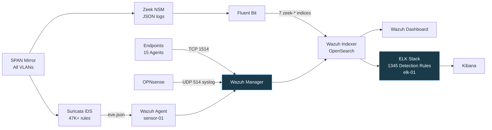
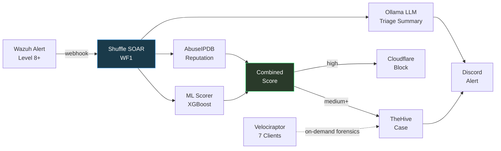
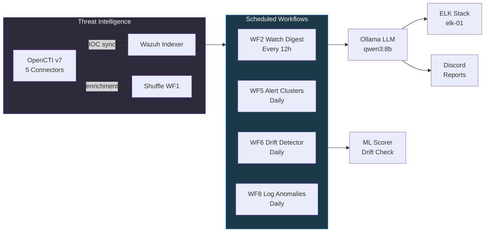
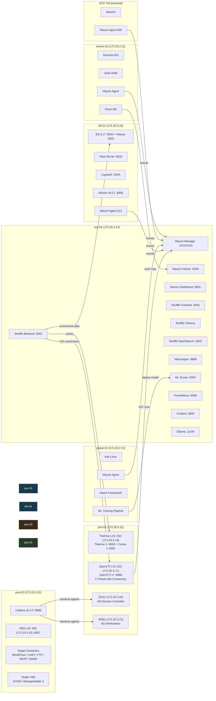
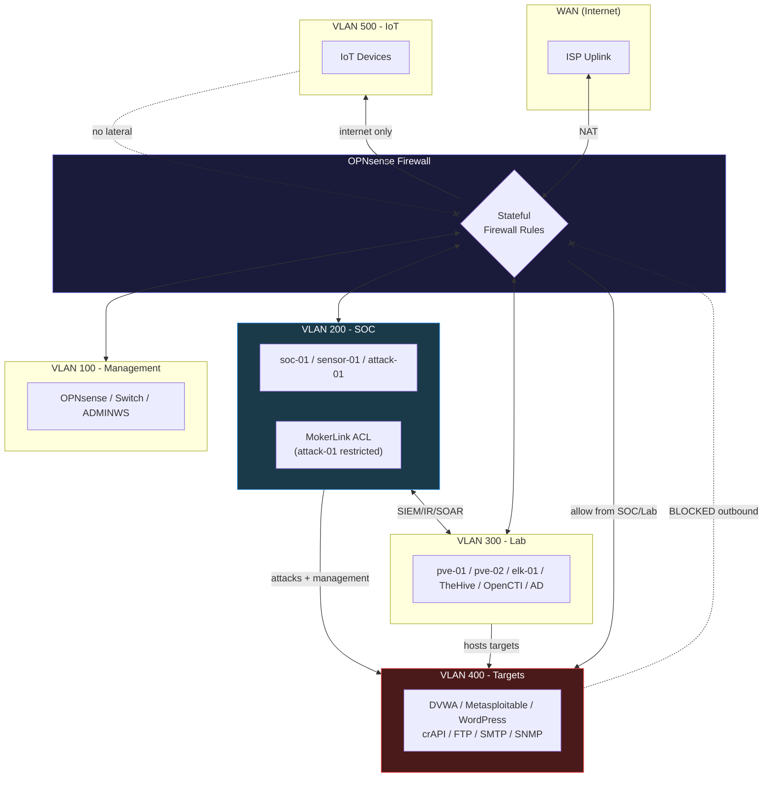

# Architecture

**Author:** Brian Chaplow
**Last Updated:** 2026-03-16

Full technical architecture of the HomeLab SOC v3 platform -- hardware, network, services, data flows, and security design. Initial 11 migration phases completed in 4 days (Feb 10-13, 2026). Phase 12 infrastructure redesign completed Mar 14-16, 2026.

---

## Table of Contents

- [Hardware Inventory](#hardware-inventory)
- [Network Architecture](#network-architecture)
- [Service Architecture](#service-architecture)
- [Data Flow](#data-flow)
- [Security Architecture](#security-architecture)
- [Architecture Diagrams](#architecture-diagrams)

---

## Hardware Inventory

The lab uses BBQ-themed naming -- a nod to the intersection of low-and-slow cooking and security operations (patience is a virtue in both).

| Host | Hardware | CPU | RAM | Storage | Role |
|------|----------|-----|-----|---------|------|
| **soc-01** | Lenovo ThinkStation P3 Tiny Gen 2 | Intel Ultra 9 285 (24C/24T) | 64 GB DDR5 | 1 TB + 2 TB NVMe | v3 SOC platform -- SIEM, SOAR, DFIR, ML, LLM |
| **sensor-01** | QNAP TVS-871 NAS | Intel i7-4790S (4C/8T) | 16 GB DDR3 | 32 TB (8x4TB RAID) | Network sensor (Suricata + Zeek), metrics, backup target |
| **attack-01** | ASUS ROG Strix G512LI | Intel i5-10300H (4C/8T) | 32 GB DDR4 | 512 GB NVMe | Kali attack box, ML model training (GTX 1650 Ti) |
| **pve-01** | Lenovo ThinkStation P340 Tiny | Intel i7-10700T (8C/16T) | 32 GB DDR4 | 512 GB NVMe | Proxmox VE -- AD lab, TheHive, OpenCTI |
| **pve-02** | Lenovo ThinkStation P340 Tiny | Intel i7-10700T (8C/16T) | 32 GB DDR4 | 512 GB NVMe | Proxmox VE -- Caldera, attack targets, PBS |
| **elk-01** | Lenovo ThinkStation P340 Tiny | Intel i7-10700T (8C/16T) | 32 GB DDR4 | 2 TB + 2 TB NVMe | Detection & PCAP -- ELK 8.17, Arkime v6.0.1, Quadro P1000 4GB |
| **ADMIN-WS** | ASUS TUF Dash F15 | Intel i7-12650H (10C/16T) | 64 GB DDR5 | 2 TB NVMe | Primary workstation (Windows 11) |
| **OPNsense** | Protectli VP2420 | Intel J6412 (4C/4T) | 8 GB DDR4 | 128 GB eMMC | Firewall / router -- inter-VLAN routing, NAT |
| **MokerLink** | 10G08410GSM | -- | -- | -- | L3 managed switch (8x 10GbE + 4x SFP+), SPAN, ACL |
| **GCP VM** | Google Cloud e2-medium | 2 vCPU | 4 GB | 50 GB | Portfolio hosting, Wazuh agent (honeypot decommissioned 2026-03-12) |

**GPU acceleration:**
- **soc-01** -- NVIDIA RTX A1000 (8 GB GDDR6) for ML inference (ml-scorer) and LLM inference (Ollama qwen3:8b)
- **attack-01** -- NVIDIA GTX 1650 Ti (4 GB GDDR6) for ML model training (XGBoost, LightGBM, IsolationForest)
- **elk-01** -- NVIDIA Quadro P1000 (4 GB GDDR5) available for compute (driver 535, added during rack build 2026-04-07)

---

---

## Network Architecture

### VLAN Design

Five VLANs provide logical segmentation, all routed through OPNsense with strict inter-VLAN firewall rules.

| VLAN | Subnet | Gateway | Purpose |
|------|--------|---------|---------|
| 100 | 172.20.1.0/24 | 172.20.1.1 | Management -- firewall, switch, workstation |
| 200 | 172.20.2.0/24 | 172.20.2.1 | SOC infrastructure -- SIEM, sensors, attack box |
| 300 | 172.20.3.0/24 | 172.20.3.1 | Lab -- Proxmox hosts, AD domain, incident response |
| 400 | 172.20.4.0/24 | 172.20.4.1 | Targets -- **fully isolated**, attack surfaces only |
| 500 | 172.20.5.0/24 | 172.20.5.1 | IoT -- internet-only, no lateral movement |

An additional family network (172.21.1.0/24 DMZ + 172.21.2.0/24 LAN) is segregated via the OPNsense `igc3` interface to an ASUS consumer router, completely isolated from the lab VLANs.

### Physical Topology

OPNsense connects to the MokerLink switch via an 802.1Q trunk carrying all five VLANs. The switch handles L2 forwarding and SPAN port mirroring, while OPNsense handles all inter-VLAN routing and firewall policy.

| Switch Port | Host | VLAN(s) | Notes |
|-------------|------|---------|-------|
| TE2 | pve-01 | 300 | Proxmox host (AD lab, TheHive, OpenCTI) |
| TE3 | pve-02 | 300 + 400 (trunk) | Proxmox host (Caldera, target VMs, Docker targets) |
| TE4 | attack-01 | 200 | Attack box (ACL-restricted, see below) |
| TE7 | soc-01 | 200 | SOC platform |
| TE8 | elk-01 | 300 | Detection & PCAP (ELK Stack, Arkime) |
| TE9 | sensor-01 | 200 | Primary NIC (sensor data + management) |
| TE10 | sensor-01 | mirror | SPAN capture (all ports mirrored, no IP assigned) |
| TE11 | (reserved) | mirror | SFP+ slot reserved for elk-01 SPAN capture (pending SFP+ RJ45 transceiver) |

### OPNsense Interface Map

| NIC | OPNsense Name | VLAN | IP | Purpose |
|-----|---------------|------|----|---------|
| igc0 | (trunk parent) | all | -- | 802.1Q trunk to MokerLink |
| igc0_vlan100 | LAN | 100 | 172.20.1.1/24 | Management gateway |
| vlan01 | SOC | 200 | 172.20.2.1/24 | SOC infrastructure gateway |
| vlan02 | Lab | 300 | 172.20.3.1/24 | Lab / Proxmox gateway |
| vlan03 | Targets | 400 | 172.20.4.1/24 | Isolated targets gateway |
| vlan04 | IoT | 500 | 172.20.5.1/24 | IoT gateway |
| igc1 | WAN | -- | DHCP | ISP uplink |
| igc3 | AsusRouter | -- | 172.21.1.1/24 | Family network handoff |

### Inter-VLAN Firewall Rules

| Source | Destination | Action | Purpose |
|--------|-------------|--------|---------|
| VLAN 200 (SOC) | VLAN 400 (Targets) | ALLOW | attack-01 attacks target hosts |
| VLAN 300 (Lab) | VLAN 400 (Targets) | ALLOW | pve-02 hosts target containers via ipvlan |
| VLAN 400 (Targets) | Any | DENY (except established) | Targets cannot initiate outbound connections |
| VLAN 500 (IoT) | Internet only | ALLOW | IoT has no lateral movement capability |
| VLAN 200 (SOC) | VLAN 300 (Lab) | ALLOW | soc-01 manages TheHive, ELK, Caldera |
| All VLANs | VLAN 100 (Mgmt) | Restricted | Only management protocols allowed |

### MokerLink ACL Micro-Segmentation

Intra-VLAN traffic between attack-01 and soc-01 (both on VLAN 200) is L2-switched and never reaches OPNsense. The MokerLink L3 switch enforces a stateless ACL on attack-01's physical port (TE4) to restrict which services the attack box can reach on the SOC platform.

**Permitted flows (attack-01 to soc-01):**
- TCP 1514 -- Wazuh agent registration
- TCP 1515 -- Wazuh agent enrollment
- TCP 9200 -- OpenSearch (ML pipeline data queries)

**Permitted flows (soc-01 to attack-01):**
- TCP 9100 -- Prometheus node_exporter scrape
- TCP 22 -- SSH management

**Everything else between attack-01 and soc-01 is denied.** This prevents the attack box from reaching Shuffle, Grafana, Velociraptor, or other sensitive management interfaces, even though they share the same subnet.

> Because switch ACLs are stateless, each soc-01-initiated connection to attack-01 requires an explicit return-traffic rule matching on source port. Without it, the SYN-ACK from attack-01 hits the deny-all before reaching the catch-all permit.

---

## Service Architecture

### soc-01 (172.20.2.14) -- v3 SOC Platform

The primary SOC server runs 12 Docker containers plus Ollama as a host service. Ubuntu 24.04 LTS. Capitol Signals API also runs here (port 5010).

| Service | Container | Port(s) | Purpose |
|---------|-----------|---------|---------|
| Wazuh Manager | wazuh.manager | 1514, 1515, 514/UDP, 55000 | SIEM -- 15 agents + OPNsense syslog |
| Wazuh Indexer | wazuh.indexer | 9200 | OpenSearch backend (wazuh-alerts + zeek indices) |
| Wazuh Dashboard | wazuh.dashboard | 5601 | SIEM web interface |
| Shuffle Frontend | shuffle-frontend | 3443 | SOAR web interface |
| Shuffle Backend | shuffle-backend | 5001 | SOAR API + workflow engine (8 workflows) |
| Shuffle Orborus | shuffle-orborus | -- | Worker container orchestrator |
| Shuffle OpenSearch | shuffle-opensearch | 9202 | SOAR internal state store |
| Velociraptor | velociraptor | 8889, 8000, 8001 | DFIR server (7 enrolled clients) |
| ML Scorer | ml-scorer | 5002 | XGBoost threat scoring API (FastAPI + GPU) |
| Prometheus | prometheus | 9090 | Metrics collection (7 scrape targets) |
| Grafana | grafana | 3000 | SOC v3 Overview dashboard |
| Ollama (host) | -- (systemd) | 11434 | LLM inference (qwen3:8b, 8B params) |

**SOAR Workflows (Shuffle):**

| Workflow | Trigger | Function |
|----------|---------|----------|
| WF1 | Webhook (Wazuh level 8+) | Threat enrichment (AbuseIPDB + ML + LLM) and auto-block |
| WF2 | Cron (every 12h) | Watch turnover digest with LLM narrative |
| WF3 | Webhook | Detection gap analysis (Caldera campaign vs alerts) |
| WF5 | Cron (daily 0600 EST) | Alert cluster triage with LLM |
| WF6 | Cron (daily 0900 EST) | ML model drift detection |
| ~~WF7~~ | ~~Cron (weekly Sun 1200 EST)~~ | ~~Honeypot intelligence report (decommissioned with honeypot 2026-03-12)~~ |
| WF8 | Cron (daily 1500 EST) | LLM-based log anomaly detection |

### sensor-01 (172.20.2.11) -- Network Sensors

QNAP NAS running sensor containers. The SPAN port (TE10) mirrors all switch traffic for full packet visibility.

| Service | Purpose |
|---------|---------|
| Suricata | Network IDS on eth4 (SPAN) -- 47,487 ET Open rules + 10 custom rules |
| Zeek | Network security monitor on eth4 -- JSON logs (conn, dns, http, ssl, ssh, files, notice) |
| Fluent Bit | Ships Zeek JSON to soc-01 OpenSearch (7 zeek-* indices) |
| Wazuh Agent | Ships Suricata eve.json + host events to soc-01 Wazuh Manager |

> v2 metrics stack (Telegraf, InfluxDB, Grafana) was decommissioned during the Phase 12 infrastructure redesign (March 2026). Prometheus on soc-01 now handles all infrastructure metrics.

### pve-01 (172.20.3.11) -- Proxmox VE (AD Lab + IR + Threat Intel)

| VM/LXC | IP | Resources | Services |
|---------|-----|-----------|----------|
| DC01 | 172.20.3.20 | 2C / 4 GB | Active Directory Domain Controller (Win Server 2022) |
| WS01 | 172.20.3.21 | 4C / 4 GB | AD Workstation (Windows 10) |
| TheHive LXC 200 | 172.20.3.13 | 4C / 8 GB | TheHive 4 + Cortex 3 (5 analyzers: AbuseIPDB, VirusTotal, Shodan, Abuse_Finder, GoogleDNS) |
| ~~ELK LXC 201~~ | ~~172.20.3.14~~ | ~~6C / 10 GB~~ | ~~Migrated to elk-01 bare metal (Phase 12) -- LXC shut down, not yet destroyed~~ |
| OpenCTI LXC 202 | 172.20.3.17 | 4C / 10 GB | OpenCTI v7 threat intelligence platform (:8080), 6 external connectors |

### pve-02 (172.20.3.12) -- Proxmox VE (Adversary Simulation + Targets)

| Service | IP / Port | Purpose |
|---------|-----------|---------|
| Caldera v5.3.0 | :8888 | Adversary simulation (MITRE ATT&CK, 4 Sandcat agents) |
| PBS LXC 300 | 172.20.3.15:8007 | Proxmox Backup Server (NFS to sensor-01 17 TB) |
| DVWA + Juice Shop | 172.20.4.11 | Vulnerable web applications (Proxmox VM) |
| Metasploitable 3 (Linux) | 172.20.4.12 | Multi-service target (Proxmox VM) |
| Metasploitable 3 (Windows) | 172.20.4.13 | Multi-service target (Proxmox VM) |
| WordPress | 172.20.4.14 | WPScan target (Docker, ipvlan L2 on VLAN 400) |
| crAPI | 172.20.4.15 | REST API target (Docker, ipvlan L2) |
| vsftpd | 172.20.4.16 | FTP target (Docker, ipvlan L2) |
| Honeypot | 172.20.4.17 | WAF evasion target (Docker, ipvlan L2) |
| SMTP relay | 172.20.4.18 | SMTP target (Docker, ipvlan L2) |
| SNMPd | 172.20.4.19 | SNMP target (Docker, ipvlan L2) |

> Docker targets on pve-02 use **ipvlan L2** networking on vmbr0v40 (VLAN 400 bridge) to place containers directly on the isolated target subnet without NAT.

### elk-01 (172.20.3.16) -- Detection & PCAP

Bare metal ThinkStation P340 Tiny running ELK Stack (migrated from pve-01 LXC 201) and Arkime full packet capture. Ubuntu 24.04 LTS. Elasticsearch runs with a 12GB JVM heap -- a significant upgrade from the 6GB heap constrained by LXC 201's 10GB RAM allocation.

| Service | Port(s) | Purpose |
|---------|---------|---------|
| Elasticsearch 8.17 | 9200 | Detection engine backend (1345 rules) |
| Kibana | 5601 | Detection dashboards and Fleet management |
| Fleet Server | 8220 | Elastic Agent management (4 agents: sensor-01, DC01, WS01, attack-01) |
| Logstash | 5044 | Log pipeline processing |
| Arkime v6.0.1 | 8005 | Full packet capture and session analysis (capture pending SFP+ transceiver) |
| Wazuh Agent (014) | -- | Ships host events to soc-01 Wazuh Manager |
| node-exporter | 9100 | Prometheus metrics |

### OpenCTI LXC 202 (172.20.3.17) -- Threat Intelligence

LXC container on pve-01 running the OpenCTI v7 threat intelligence platform. Aggregates structured threat intelligence from 5 external sources and integrates with both the SIEM (Wazuh CDB list sync) and SOAR (Shuffle WF1 enrichment) pipelines.

| Service | Port | Purpose |
|---------|------|---------|
| OpenCTI Platform | 8080 | Threat intelligence management UI and API |
| MITRE ATT&CK connector | -- | ATT&CK framework import (techniques, groups, software) |
| CVE (NVD) connector | -- | CVE vulnerability feed |
| AbuseIPDB connector | -- | IP reputation feed |
| CISA KEV connector | -- | Known Exploited Vulnerabilities catalog |
| Malpedia connector | -- | Malware family and YARA rule feed |

### GCP VM (External) -- Web Hosting

| Service | Purpose |
|---------|---------|
| Apache | Portfolio site (brianchaplow.com) + blog (bytesbourbonbbq.com) |
| Wazuh Agent (009) | Ships security events to soc-01 Wazuh Manager |

> Honeypot campaign (WordPress login honeypot, Fluent Bit log shipping) ended 2026-03-12. GCP honeypot services stopped. Historical honeypot data preserved in ELK indices on elk-01.

---

## Data Flow

### Primary SIEM Pipeline

All endpoint agents (Windows, Linux, network devices) ship events to the Wazuh Manager on soc-01 via TCP 1514. OPNsense ships syslog via UDP 514. The Wazuh Manager normalizes, enriches, and indexes alerts into OpenSearch.

```
Endpoints (12 agents)  ──TCP 1514──>  Wazuh Manager  ──>  OpenSearch (wazuh-alerts-4.x-*)
OPNsense               ──UDP 514───>       |
                                           v
                                    Wazuh Dashboard (:5601)
```

### Network Sensor Pipeline

sensor-01 captures all network traffic via SPAN port mirroring. Suricata provides IDS alerts; Zeek provides connection metadata.

```
All VLANs ──SPAN mirror──> sensor-01 eth4 (TE10)
                               |
                    +----------+----------+
                    |                     |
                Suricata              Zeek (JSON)
              (eve.json)                  |
                    |              Fluent Bit
              Wazuh Agent              |
                    |                  v
                    v          soc-01 OpenSearch
            soc-01 Wazuh      (zeek-conn, zeek-dns,
          (wazuh-alerts-*)      zeek-http, zeek-ssl,
                                zeek-ssh, zeek-notice,
                                zeek-files)
```

### SOAR Enrichment Pipeline

When Wazuh generates a level 8+ alert, it fires a webhook to Shuffle WF1, which enriches the alert with threat intelligence, ML scoring, and LLM triage before routing to the appropriate response channel.

```
Wazuh Alert (level 8+) ──webhook──> Shuffle WF1
                                       |
                        +--------------+--------------+--------------+
                        |              |              |              |
                   AbuseIPDB      ML Scorer      Ollama (LLM)   OpenCTI
                   (reputation)   (XGBoost)      (triage text)  (IOC lookup)
                        |              |              |
                        +--------------+--------------+
                                       |
                                 Combined Score
                                       |
                        +--------------+--------------+
                        |              |              |
                   TheHive Case   Discord Alert   Cloudflare Block
                   (if score > T)  (always)       (disabled for honeypot)
```

### Honeypot Research Pipeline (Decommissioned 2026-03-12)

The GCP-hosted WordPress login honeypot campaign ran from Feb-Mar 2026, capturing credential stuffing attempts. Logs were shipped to the ELK stack via Tailscale overlay networking. The campaign ended 2026-03-12; GCP honeypot services have been stopped. Historical data is preserved in ELK indices on elk-01.

```
Internet Attackers ──> GCP VM (Honeypot)          [DECOMMISSIONED]
                           |
              +------------+------------+
              |            |            |
         credentials   access logs   Wazuh alerts
         (PHP log)     (Apache)      (agent 009)
              |            |            |
         Fluent Bit    Fluent Bit   honeypot-wazuh-sync.py
         (Tailscale)   (Tailscale)  (cron, every 15 min)
              |            |            |
              v            v            v
         elk-01 (172.20.3.16) -- formerly ELK LXC 201
         honeypot-       honeypot-     honeypot-
         credentials     access        wazuh
```

### Threat Intelligence Pipeline

OpenCTI aggregates structured threat intelligence from 5 external feeds and distributes IOCs to detection systems.

```
External Feeds
  MITRE ATT&CK / CVE (NVD) / AbuseIPDB / CISA KEV / Malpedia
         |
    OpenCTI v7 (pve-01 LXC 202, :8080)
         |
    +----+----+
    |         |
  Wazuh     Shuffle WF1
  (CDB list  (IOC enrichment
   IOC sync)  during triage)
```

### ML Pipeline Data Flow

The ML pipeline on attack-01 queries OpenSearch for training data, trains models offline, and deploys the best performer to the ml-scorer API on soc-01 for real-time inference.

```
OpenSearch (soc-01:9200)
  wazuh-alerts-4.x-* + zeek-conn
         |
    Data Extraction (attack-01)
         |
    Zeek Enrichment (5-tuple join)
         |
    Ground Truth Labels (Caldera API)
         |
    Feature Engineering (70+ features)
         |
    Model Training (XGBoost, LightGBM, RF, LogReg, Hybrid)
         |
    Best Model (XGBoost, PR-AUC 0.9998)
         |
    Deploy to ml-scorer (soc-01:5002, FastAPI + Docker)
         |
    Shuffle WF1 (real-time scoring) + WF6 (drift detection)
```

### Metrics Pipeline

```
soc-01 node_exporter    ──>
soc-01 tenzir_exporter  ──>
elk-01 node_exporter      ──>  Prometheus (soc-01:9090)  ──>  Grafana (soc-01:3000)
pve-01 node_exporter    ──>         |                        SOC v3 Overview Dashboard
pve-02 node_exporter     ──>         |
attack-01 node_exporter       ──>         v
prometheus self-scrape   ──>  Self-monitoring
```

---

## Security Architecture

### Defense-in-Depth Layers

The lab implements multiple overlapping security boundaries:

**Layer 1 -- Perimeter (OPNsense)**
- Stateful firewall on all inter-VLAN traffic
- NAT for outbound internet access
- Syslog forwarding to Wazuh for firewall event visibility

**Layer 2 -- Network Segmentation (VLANs)**
- Five VLANs isolate functional zones
- VLAN 400 (Targets) is fully isolated -- cannot initiate outbound connections
- VLAN 500 (IoT) restricted to internet-only access
- Family network physically separated via dedicated OPNsense interface

**Layer 3 -- Switch ACL Micro-Segmentation (MokerLink)**
- Stateless ACL on attack-01's switch port restricts intra-VLAN access to soc-01
- Only Wazuh agent (1514/1515), OpenSearch (9200), and management flows (SSH, Prometheus) permitted
- Prevents the attack box from reaching SOAR, dashboards, or DFIR interfaces

**Layer 4 -- Host-Level Controls**
- Wazuh agents on all endpoints (12 agents) for file integrity, vulnerability scanning, SCA
- Suricata IDS (47,487+ rules) on SPAN port for full network visibility
- Zeek for protocol-level connection metadata and anomaly detection

**Layer 5 -- Detection and Response**
- 1345 Elastic Security detection rules (MITRE ATT&CK coverage, migrated to elk-01 bare metal)
- 8 Shuffle SOAR workflows for automated enrichment, triage, and response
- TheHive + Cortex for case management with 5 threat intelligence analyzers
- OpenCTI v7 threat intelligence platform with 6 external connectors (MITRE ATT&CK, CVE, AbuseIPDB, CISA KEV, Malpedia, AlienVault OTX)
- Velociraptor for endpoint forensics and live response (7 clients)

**Layer 6 -- AI/ML Augmentation**
- XGBoost threat scorer (PR-AUC 0.9998) for real-time alert scoring
- Ollama LLM (qwen3:8b) for alert triage narratives, anomaly classification, and intel reports
- Model drift detection (WF6) ensures ML accuracy over time
- LLM log anomaly finder (WF8) catches patterns missed by rule-based detection

### VLAN 400 Isolation Model

The target network is designed to be attacked. Its isolation ensures that compromised targets cannot pivot to production infrastructure:

- OPNsense blocks all outbound traffic from VLAN 400 except established return traffic
- Target VMs on pve-02 connect via Proxmox bridge (vmbr0v40) on VLAN 400 subinterface
- Docker targets use ipvlan L2 networking -- containers sit directly on VLAN 400, no NAT
- SOC VLAN (200) and Lab VLAN (300) can reach targets for attacks and management
- Target VLAN cannot reach any other VLAN

### Tailscale Overlay Network

A Tailscale mesh connects external and internal lab resources without exposing any services to the public internet:

- **GCP VM** -- web hosting, Wazuh agent (honeypot decommissioned)
- **elk-01** -- ELK Stack (GCP Fluent Bit repointed here from former LXC 201)
- No subnet routes advertised -- only point-to-point peer access
- Lab internal IPs (172.20.x.x) are not routable from GCP

---

## Architecture Diagrams

### Detection Pipeline

How threats are detected -- from network traffic and endpoint events through to indexed, searchable alerts.



### Response Pipeline

How the SOC responds to detections -- from alert trigger through enrichment to automated action.



### Intelligence Pipeline

How the SOC generates intelligence -- scheduled analysis, honeypot research, and drift monitoring.



### Service Deployment Map



### VLAN Security Zones



---

*Architecture maintained by Brian Chaplow. For questions about this lab or its components, see the individual component READMEs in this repository.*
