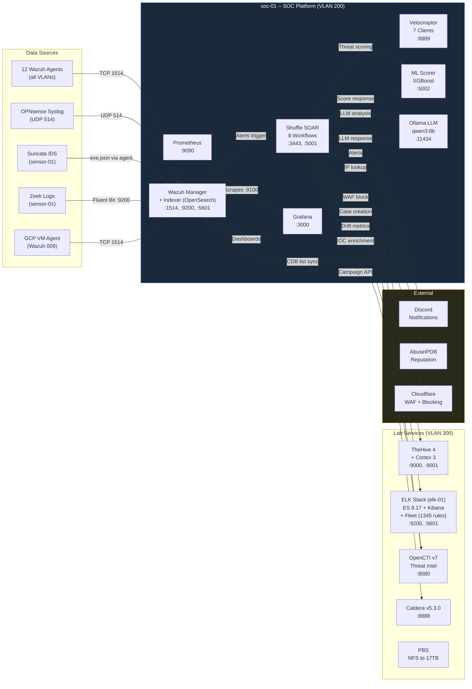
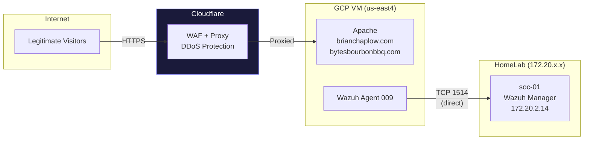

# Network Topology

**Author:** Brian Chaplow
**Last Updated:** 2026-03-16

Detailed network architecture for the HomeLab SOC v3 environment. Covers VLAN segmentation, firewall policy, switch ACL micro-segmentation, and data flow between all components.

---

## Table of Contents

- [VLAN Architecture](#vlan-architecture)
- [Host Inventory](#host-inventory)
- [OPNsense Interface Map](#opnsense-interface-map)
- [Firewall Rule Summary](#firewall-rule-summary)
- [MokerLink ACL Micro-Segmentation](#mokerlink-acl-micro-segmentation)
- [Physical Topology](#physical-topology)
- [Logical Topology](#logical-topology)
- [GCP External Connectivity](#gcp-external-connectivity)

---

## VLAN Architecture

The network is segmented into five 802.1Q VLANs plus two family network subnets, all routed through OPNsense with strict inter-VLAN policy enforcement. Each VLAN serves a distinct security function, enabling controlled east-west traffic between SOC tools, lab systems, and isolated attack targets.

| VLAN ID | Subnet | Gateway | Purpose | Notes |
|---------|--------|---------|---------|-------|
| 100 | 172.20.1.0/24 | 172.20.1.1 | Management | Firewall, switch, admin workstation |
| 200 | 172.20.2.0/24 | 172.20.2.1 | SOC Infrastructure | SIEM, SOAR, sensors, ML scoring, LLM inference |
| 300 | 172.20.3.0/24 | 172.20.3.1 | Lab / Proxmox / AD | Hypervisors, AD domain, TheHive, ELK (elk-01), OpenCTI, backup |
| 400 | 172.20.4.0/24 | 172.20.4.1 | Targets (ISOLATED) | Attack targets only -- no outbound except established |
| 500 | 172.20.5.0/24 | 172.20.5.1 | IoT | Internet-only, no lateral movement |
| -- | 172.21.1.0/24 | 172.21.1.1 | Family DMZ | ASUS router WAN-side, isolated from SOC VLANs |
| -- | 172.21.2.0/24 | 172.21.2.1 | Family LAN (WiFi) | Consumer devices, no SOC access |

### Design Rationale

- **VLAN 400 is fully isolated.** Targets cannot initiate connections to any other VLAN or the internet. Only established/related return traffic is permitted. This ensures attack exercises remain contained.
- **VLAN 200 houses all SOC tooling** on a dedicated subnet, separated from the lab hypervisors and AD domain on VLAN 300.
- **VLAN 500 (IoT)** has internet-only access with no lateral movement to any internal VLAN.
- **Family networks** are physically separated via the ASUS router connected to a dedicated OPNsense interface (igc3), completely isolated from SOC operations.

---

## Host Inventory

### VLAN 100 -- Management

| Hostname | IP | Hardware | Role |
|----------|----|----------|------|
| OPNsense | 172.20.1.1 | Protectli VP2420 (J6412, 8GB) | Firewall / router / VLAN gateway |
| MokerLink | 172.20.1.11 | 10G08410GSM (8x10GE + 4xSFP+) | L3 managed switch, 802.1Q trunking, port ACLs |
| ADMIN-WS | 172.20.1.12 | ASUS TUF Dash F15 (i7-12650H, 64GB) | Windows admin workstation |

### VLAN 200 -- SOC Infrastructure

| Hostname | IP | Hardware | Role |
|----------|----|----------|------|
| sensor-01 | 172.20.2.11 | QNAP TVS-871 (i7-4790S, 16GB) | Sensor node -- Suricata IDS + Zeek on SPAN port |
| attack-01 | 172.20.2.12 | ASUS ROG Strix G512LI (i7-10750H, 32GB, GTX 1650 Ti) | Kali attack box, ML model training |
| **soc-01** | **172.20.2.14** | **Intel Ultra 9 285, 64GB, RTX A1000** | **Primary SOC platform -- Wazuh, Shuffle, Velociraptor, ML scorer, Ollama** |

### VLAN 300 -- Lab / Proxmox / AD

| Hostname | IP | Hardware / Resources | Role |
|----------|----|----------------------|------|
| pve-01 | 172.20.3.11 | ThinkStation P340 Tiny (i7-10700T, 32GB) | Proxmox host -- AD lab VMs, TheHive LXC, OpenCTI LXC |
| pve-02 | 172.20.3.12 | ThinkStation P340 Tiny (i7-10700T, 32GB) | Proxmox host -- target VMs, Caldera, PBS LXC |
| TheHive LXC 200 | 172.20.3.13 | LXC on pve-01 (4 vCPU, 8GB) | TheHive 4 + Cortex 3 (case management, 5 analyzers) |
| ~~ELK LXC 201~~ | ~~172.20.3.14~~ | ~~LXC on pve-01 (6 vCPU, 10GB)~~ | ~~Decommissioned -- ELK migrated to elk-01 bare metal (Phase 12)~~ |
| PBS LXC 300 | 172.20.3.15 | LXC on pve-02 (2 vCPU, 2GB) | Proxmox Backup Server (NFS to sensor-01 17TB) |
| **elk-01** | **172.20.3.16** | **ThinkStation P340 Tiny (i7-10700T, 32GB, 2TB+1TB NVMe)** | **Detection & PCAP -- ELK 8.17, Arkime v6.0.1** |
| OpenCTI LXC 202 | 172.20.3.17 | LXC on pve-01 (4 vCPU, 10GB) | OpenCTI v7 threat intelligence platform (6 connectors) |
| DC01 | 172.20.3.20 | VM on pve-01 (2 vCPU, 4GB) | Active Directory Domain Controller (Win Server 2022) |
| WS01 | 172.20.3.21 | VM on pve-01 (4 vCPU, 4GB) | AD Workstation (Windows 10 Eval, EOL Oct 2025) |

### VLAN 400 -- Targets (Isolated)

| Hostname | IP | Type | Role |
|----------|----|------|------|
| DVWA + Juice Shop | 172.20.4.11 | Proxmox VM | Web application targets |
| Metasploitable 3 (Linux) | 172.20.4.12 | Proxmox VM | Multi-service exploitation target |
| Metasploitable 3 (Win) | 172.20.4.13 | Proxmox VM | Multi-service exploitation target |
| WordPress | 172.20.4.14 | Docker on pve-02 (ipvlan L2) | WPScan target |
| crAPI | 172.20.4.15 | Docker on pve-02 (ipvlan L2) | REST API security target |
| vsftpd | 172.20.4.16 | Docker on pve-02 (ipvlan L2) | FTP exploitation target |
| Honeypot | 172.20.4.17 | Docker on pve-02 (ipvlan L2) | WAF evasion target |
| SMTP relay | 172.20.4.18 | Docker on pve-02 (ipvlan L2) | SMTP target |
| SNMPd | 172.20.4.19 | Docker on pve-02 (ipvlan L2) | SNMP target |

> **Note:** Docker targets on pve-02 use `ipvlan L2` networking to place containers directly on VLAN 400 (172.20.4.0/24) while the host itself remains on VLAN 300. This avoids NAT and gives each target a real routable IP within the isolated subnet.

### External

| Hostname | IP | Location | Role |
|----------|----|----------|------|
| GCP VM | External (Tailscale overlay) | Google Cloud (us-east4) | brianchaplow.com + bytesbourbonbbq.com hosting, Wazuh agent (honeypot decommissioned 2026-03-12) |

---

## OPNsense Interface Map

OPNsense runs on a Protectli VP2420 appliance with four Intel i225/i226-V NICs. The primary uplink (igc0) carries an 802.1Q trunk to the MokerLink switch, with all five VLANs tagged on a single physical link.

| NIC | OPNsense Name | VLAN | IP Address | Connection |
|-----|---------------|------|------------|------------|
| igc0 | (trunk parent) | all | none | 802.1Q trunk to MokerLink switch |
| igc0_vlan100 | LAN | 100 | 172.20.1.1/24 | Management VLAN |
| vlan01 | SOC (opt1) | 200 | 172.20.2.1/24 | SOC infrastructure VLAN |
| vlan02 | Lab (opt2) | 300 | 172.20.3.1/24 | Lab / Proxmox / AD VLAN |
| vlan03 | Targets (opt3) | 400 | 172.20.4.1/24 | Attack targets VLAN |
| vlan04 | IoT (opt4) | 500 | 172.20.5.1/24 | IoT VLAN |
| igc1 | WAN | -- | DHCP | Verizon ISP uplink |
| igc3 | AsusRouter (opt5) | -- | 172.21.1.1/24 | Family network (ASUS router) |

### Key Interface Details

- **igc0** is the single physical uplink carrying all VLAN traffic to the switch. All sub-interfaces are created as VLAN tags on this trunk.
- **igc1 (WAN)** receives a public IP via DHCP from the ISP.
- **igc3** connects directly to the family ASUS router, creating a hard boundary between SOC and family traffic. No VLAN tagging -- this is a separate physical segment.

---

## Firewall Rule Summary

All inter-VLAN traffic routes through OPNsense, where stateful packet filtering (pf) enforces the following policy. VLAN 400 isolation is the cornerstone of the security architecture -- attack exercises never leak beyond the target subnet.

### Inter-VLAN Routing Policy

| Source | Destination | Action | Purpose |
|--------|-------------|--------|---------|
| VLAN 100 (Management) | All VLANs | ALLOW | Admin workstation needs full access |
| VLAN 200 (SOC) | VLAN 300 (Lab) | ALLOW | soc-01 communicates with TheHive, ELK, Proxmox |
| VLAN 200 (SOC) | VLAN 400 (Targets) | ALLOW | attack-01 runs attacks against targets |
| VLAN 300 (Lab) | VLAN 200 (SOC) | ALLOW | TheHive/ELK report to Wazuh/Shuffle on soc-01 |
| VLAN 300 (Lab) | VLAN 400 (Targets) | ALLOW | pve-02 hosts Docker target containers on VLAN 400 |
| VLAN 400 (Targets) | ANY | **DENY** | Targets are fully isolated (established/related only) |
| VLAN 500 (IoT) | Internet only | ALLOW | No lateral movement to internal VLANs |
| Family (192.168.x.x) | SOC VLANs | **DENY** | Hard physical + logical separation |

### VLAN 400 Isolation Detail

VLAN 400 enforces a strict **deny-all outbound** policy with one exception: established/related return traffic is permitted. This means:

- Targets can **respond** to connections initiated from VLAN 200 (attack traffic) or VLAN 300 (management)
- Targets **cannot** initiate connections to the internet, other VLANs, or even other targets
- All attack exercises are fully contained within this subnet
- OPNsense syslog from VLAN 400 is forwarded to Wazuh for visibility

### Key Service Flows Through the Firewall

| Flow | Source | Destination | Ports | Purpose |
|------|--------|-------------|-------|---------|
| Wazuh agent reporting | All VLANs | soc-01 (172.20.2.14) | TCP 1514, 1515 | Agent enrollment and event shipping |
| OPNsense syslog | OPNsense (172.20.1.1) | soc-01 (172.20.2.14) | UDP 514 | Firewall log ingestion |
| Prometheus scraping | soc-01 (172.20.2.14) | All monitored hosts | TCP 9100 | Node exporter metrics collection |
| TheHive case management | soc-01 (172.20.2.14) | TheHive (172.20.3.13) | TCP 9000 | Shuffle creates/queries cases |
| ELK data shipping | soc-01 (172.20.2.14) | elk-01 (172.20.3.16) | TCP 9200 | Drift metrics, workflow data |
| Caldera C2 | pve-02 (172.20.3.12) | VLAN 400 targets | TCP 8888 | Sandcat agent communication |
| Zeek/Suricata shipping | sensor-01 (172.20.2.11) | soc-01 (172.20.2.14) | TCP 9200 | Fluent Bit ships Zeek logs to OpenSearch |

---

## MokerLink ACL Micro-Segmentation

### The Problem

attack-01 (172.20.2.12) and soc-01 (172.20.2.14) are both on VLAN 200. Intra-VLAN traffic is Layer 2 switched -- it **never routes through OPNsense**, so firewall rules do not apply. Without additional controls, a compromised attack-01 could access every service on soc-01 (Shuffle SOAR, Grafana, Wazuh Dashboard, etc.).

### The Solution

The MokerLink 10G08410GSM L3 managed switch supports IPv4 ACLs bound to physical ports. ACL `attack-01-soc-01` is bound to **TE4** (attack-01's physical switch port), filtering all traffic between the two hosts at the switch level.

### ACL Characteristics

- **Bidirectional enforcement:** The MokerLink applies port-bound ACLs to both ingress and egress traffic on the bound port. There is no direction selector in the binding UI.
- **Stateless evaluation:** Unlike OPNsense's stateful pf firewall, switch ACLs do not track TCP connections. A SYN and its SYN-ACK are evaluated independently. This means every soc-01-initiated connection to attack-01 requires **two rules**: one for the outbound request (matching destination port) and one for the inbound return (matching source port).
- **Default action:** Implicit deny at the end of the ACL. An explicit catch-all PERMIT (seq 50) allows all non-attack-01-to-soc-01 traffic to pass normally.

### ACL Rules -- `attack-01-soc-01` on TE4

| Seq | Action | Proto | Source IP | Destination IP | Src Port | Dst Port | Purpose |
|-----|--------|-------|-----------|----------------|----------|----------|---------|
| 10 | PERMIT | TCP | 172.20.2.12 | 172.20.2.14 | Any | 1514 | attack-01 to soc-01: Wazuh agent |
| 20 | PERMIT | TCP | 172.20.2.12 | 172.20.2.14 | Any | 1515 | attack-01 to soc-01: Wazuh enrollment |
| 30 | PERMIT | TCP | 172.20.2.12 | 172.20.2.14 | Any | 9200 | attack-01 to soc-01: OpenSearch queries |
| 31 | PERMIT | TCP | 172.20.2.14 | 172.20.2.12 | Any | 9100 | soc-01 to attack-01: Prometheus scrape |
| 32 | PERMIT | TCP | 172.20.2.14 | 172.20.2.12 | Any | 22 | soc-01 to attack-01: SSH management |
| 33 | PERMIT | TCP | 172.20.2.12 | 172.20.2.14 | 9100 | Any | attack-01 to soc-01: Prometheus **return** |
| 34 | PERMIT | TCP | 172.20.2.12 | 172.20.2.14 | 22 | Any | attack-01 to soc-01: SSH **return** |
| 40 | **DENY** | IP | 172.20.2.12 | 172.20.2.14 | Any | Any | Block all other attack-01 to soc-01 |
| 50 | PERMIT | IP | Any | Any | Any | Any | Allow all non-matching traffic |

### How Stateless Return Rules Work

Because the ACL is stateless, soc-01-initiated connections to attack-01 need explicit return-path rules. Here is how the rule evaluation works for each flow:

**Prometheus scrape (soc-01:ephemeral to attack-01:9100):**
1. Outbound SYN exits TE4 -- matches seq 31 (dst port 9100) -- PERMIT
2. Return SYN-ACK enters TE4 from attack-01 with **src port 9100** -- matches seq 33 -- PERMIT
3. Without seq 33, the return would fall through to seq 40 (DENY)

**SSH (soc-01 to attack-01:22):**
1. Outbound SYN exits TE4 -- matches seq 32 (dst port 22) -- PERMIT
2. Return SYN-ACK enters TE4 from attack-01 with **src port 22** -- matches seq 34 -- PERMIT

**Blocked example -- attack-01 to soc-01:3000 (Grafana):**
1. Packet enters TE4 inbound from attack-01 -- no match on seq 10-34 -- hits seq 40 DENY

**Blocked example -- soc-01 pings attack-01 (ICMP):**
1. Outbound ICMP exits TE4 -- matches seq 50 PERMIT (catch-all)
2. ICMP reply enters TE4 from attack-01 -- IP protocol, matches seq 40 DENY
3. Ping is **intentionally blocked** by design

### Verification Results

| Test | From | To | Expected | Result |
|------|------|----|----------|--------|
| Prometheus scrape :9100 | soc-01 | attack-01 | PASS | PASS |
| OpenSearch :9200 | attack-01 | soc-01 | PASS | PASS |
| Grafana :3000 | attack-01 | soc-01 | BLOCKED | BLOCKED |
| SSH :22 | attack-01 | soc-01 | BLOCKED | BLOCKED |
| ICMP ping | soc-01 | attack-01 | BLOCKED | BLOCKED |
| Prometheus all 7 targets | soc-01 | all hosts | ALL UP | ALL UP |

---

## Physical Topology

```mermaid
graph TB
    subgraph Internet
        ISP["Verizon ISP"]
        CF["Cloudflare CDN"]
    end

    subgraph Family["Family Network (Physical Separation)"]
        ASUS["ASUS Router<br/>172.21.1.1"]
        WIFI["Family WiFi<br/>172.21.2.0/24"]
    end

    subgraph Firewall["OPNsense Firewall (Protectli VP2420)"]
        OPN["OPNsense<br/>igc1=WAN | igc0=Trunk | igc3=ASUS"]
    end

    subgraph Switch["MokerLink 10G08410GSM"]
        SW["L3 Managed Switch<br/>172.20.1.11<br/>802.1Q Trunk + Port ACLs"]
    end

    subgraph VLAN100["VLAN 100 -- Management (172.20.1.0/24)"]
        ADMINWS["ADMINWS<br/>172.20.1.12<br/>Admin Workstation"]
    end

    subgraph VLAN200["VLAN 200 -- SOC Infrastructure (172.20.2.0/24)"]
        SENSOR01["sensor-01<br/>172.20.2.11<br/>Suricata + Zeek<br/>(TE9 + TE10 SPAN)"]
        ATTACK01["attack-01<br/>172.20.2.12<br/>Kali + ML Training<br/>(TE4, ACL applied)"]
        SOC01["soc-01<br/>172.20.2.14<br/>SOC Platform<br/>(TE7)"]
    end

    subgraph VLAN300["VLAN 300 -- Lab / Proxmox / AD (172.20.3.0/24)"]
        PVE01["pve-01<br/>172.20.3.11<br/>Proxmox (TE2)"]
        PVE02["pve-02<br/>172.20.3.12<br/>Proxmox (TE3 trunk)"]
        THEHIVE["TheHive LXC 200<br/>172.20.3.13"]
        PBS["PBS LXC 300<br/>172.20.3.15"]
        ELK01["elk-01<br/>172.20.3.16<br/>ELK + Arkime (TE8)"]
        OPENCTI["OpenCTI LXC 202<br/>172.20.3.17"]
        DC01["DC01<br/>172.20.3.20"]
        WS01["WS01<br/>172.20.3.21"]
    end

    subgraph VLAN400["VLAN 400 -- Targets / ISOLATED (172.20.4.0/24)"]
        DVWA["DVWA + Juice Shop<br/>172.20.4.11"]
        MS3L["Metasploitable 3<br/>172.20.4.12"]
        MS3W["Metasploitable 3 Win<br/>172.20.4.13"]
        WP["WordPress<br/>172.20.4.14"]
        CRAPI["crAPI<br/>172.20.4.15"]
        FTP["vsftpd<br/>172.20.4.16"]
        HONEYPOT["Honeypot<br/>172.20.4.17"]
        SMTP["SMTP<br/>172.20.4.18"]
        SNMP["SNMPd<br/>172.20.4.19"]
    end

    ISP -->|"igc1 (WAN)"| OPN
    OPN -->|"igc3"| ASUS
    ASUS --- WIFI
    OPN -->|"igc0 (802.1Q trunk)<br/>VLANs 100/200/300/400/500"| SW

    SW --- ADMINWS
    SW -->|"TE9 + TE10 (SFP+)"| SENSOR01
    SW -->|"TE4 (ACL: attack-01-soc-01)"| ATTACK01
    SW -->|"TE7"| SOC01
    SW -->|"TE2"| PVE01
    SW -->|"TE3 (VLAN 300+400 trunk)"| PVE02
    SW -->|"TE8"| ELK01

    PVE01 -.->|"LXC"| THEHIVE
    PVE01 -.->|"LXC"| OPENCTI
    PVE01 -.->|"VM"| DC01
    PVE01 -.->|"VM"| WS01
    PVE02 -.->|"LXC"| PBS
    PVE02 -.->|"ipvlan L2 (VLAN 400)"| WP
    PVE02 -.->|"ipvlan L2"| CRAPI
    PVE02 -.->|"ipvlan L2"| FTP
    PVE02 -.->|"ipvlan L2"| HONEYPOT
    PVE02 -.->|"ipvlan L2"| SMTP
    PVE02 -.->|"ipvlan L2"| SNMP

    CF -->|"Internet"| ISP

    style VLAN400 fill:#4a1a1a,stroke:#ff4444,color:#fff
    style SOC01 fill:#1a3a1a,stroke:#44ff44,color:#fff
    style ELK01 fill:#1a3a1a,stroke:#44ff44,color:#fff
```

### SPAN Port Monitoring

sensor-01 connects to the MokerLink switch via two SFP+ uplinks:

- **TE9** -- Primary data connection (VLAN 200)
- **TE10** -- SPAN capture port (all switch ports mirrored, no IP address assigned)

All traffic crossing the switch is mirrored to TE10, where sensor-01 runs **Suricata** (IDS alerting) and **Zeek** (connection metadata extraction) against the full-take packet capture.

---

## Logical Topology

### Data Flow Narrative

1. **Collection:** 12 Wazuh agents across all VLANs ship security events to the Wazuh Manager on soc-01 via TCP 1514. OPNsense forwards firewall syslog via UDP 514. sensor-01 runs Suricata and Zeek against SPAN traffic, with Suricata alerts shipped through the Wazuh agent and Zeek metadata shipped directly to OpenSearch via Fluent Bit.

2. **Detection:** Wazuh correlates events against custom rules and generates alerts stored in OpenSearch (`wazuh-alerts-*`). ELK on elk-01 runs 1345 Elastic detection rules against Fleet agent data independently. OpenCTI v7 syncs threat intelligence IOCs to Wazuh CDB lists for indicator-based detection.

3. **Automation:** Shuffle SOAR orchestrates 8 workflows triggered by webhooks and system cron schedules:
   - **WF1** -- Threat enrichment (AbuseIPDB + ML score) and auto-block (Cloudflare WAF)
   - **WF2** -- Watch turnover digest (twice daily summary to Discord)
   - **WF3** -- Detection gap analysis (Caldera campaigns vs. Wazuh coverage)
   - **WF5** -- Daily alert cluster triage (LLM-powered grouping)
   - **WF6** -- ML model drift detection (daily metrics to ELK)
   - **WF8** -- LLM log anomaly finder (rare pattern classification)

4. **Response:** TheHive manages incident cases created by Shuffle. Cortex runs 5 analyzers for enrichment. Velociraptor provides endpoint DFIR across 7 clients.

5. **Adversary Simulation:** Caldera v5.3.0 on pve-02 runs MITRE ATT&CK campaigns against VLAN 400 targets with Sandcat agents, validating Wazuh detection coverage.

---

## GCP External Connectivity

### GCP Pipeline Details

The GCP VM hosts the public portfolio and BBQ blog sites behind Cloudflare. A Wazuh agent (009) ships OS-level security events to soc-01's Wazuh Manager.

> **Honeypot campaign (decommissioned 2026-03-12):** A WordPress login honeypot previously ran on the GCP VM, capturing credential stuffing attempts. Fluent Bit shipped honeypot logs to the ELK stack via Tailscale, and a cron job on soc-01 (`honeypot-wazuh-sync.py`) synced Wazuh alerts to ELK's `honeypot-wazuh` index. The campaign ended March 12, 2026. GCP honeypot services have been stopped. Historical data is preserved in ELK honeypot indices on elk-01.

**Why Tailscale?** The GCP VM has no direct route to the home network's RFC 1918 address space (172.20.x.x). Tailscale provides a WireGuard-based mesh VPN, assigning each node a stable 100.x.x.x address and handling NAT traversal automatically. No port forwarding or public exposure of internal services is required.

---

## Design Principles

1. **Defense in depth.** Network segmentation operates at three layers: OPNsense inter-VLAN firewall rules, MokerLink switch port ACLs for intra-VLAN microsegmentation, and host-level Wazuh agents for endpoint detection.

2. **Least privilege routing.** VLAN 400 targets cannot initiate any outbound connections. IoT devices (VLAN 500) can only reach the internet. The attack box (attack-01) is microsegmented from the SOC platform (soc-01) at the switch level.

3. **Full visibility.** SPAN port mirroring captures all switch traffic for Suricata/Zeek analysis. 12 Wazuh agents cover every VLAN. Prometheus scrapes 7 infrastructure targets. Every layer generates telemetry.

4. **Separation of concerns.** SOC tooling (VLAN 200), lab infrastructure (VLAN 300), and attack targets (VLAN 400) occupy distinct broadcast domains with explicit policy governing cross-VLAN communication.

5. **External integration without exposure.** The GCP VM connects home via Tailscale mesh VPN, requiring zero inbound port exposure on the home network. OpenCTI aggregates external threat feeds and distributes IOCs to internal detection systems.
